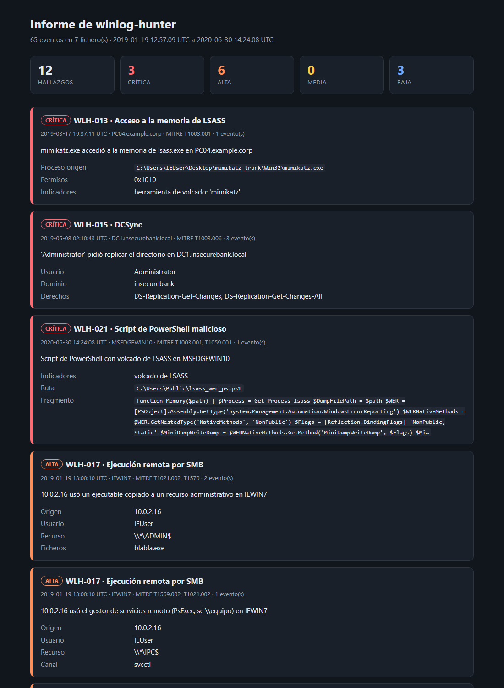

# winlog-hunter

[](https://pypi.org/project/winlog-hunter/) [](LICENSE) [](https://github.com/BV-cs0/winlog-hunter/actions/workflows/tests.yml)

Analizador de logs de Windows para blue team. Lee eventos de **Security**, **System**, **Application**, **Sysmon**, **PowerShell**, **Defender**, **BITS**, **WinRM** **RDP**, **Application Experience** y **Winsock**, detecta actividad sospechosa con 46 reglas y genera un informe con cada hallazgo mapeado a **MITRE ATT&CK**. Las reglas también están en formato **Sigma** para usarlas en cualquier SIEM.



## Instalación

Necesitas Python 3.9 o superior.

```bash
python -m pip install winlog-hunter
```

No tiene dependencias obligatorias. En Linux o macOS, para leer ficheros `.evtx` instala también el extra: `python3 -m pip install "winlog-hunter[evtx]"` (en Windows no hace falta: usa `wevtutil`, que viene con el sistema).

Para actualizar a la última versión: `python -m pip install --upgrade winlog-hunter`. Para comprobar que funciona: `winlog-hunter --version`.

**Aviso de versión nueva.** Cuando lo usas en una consola, winlog-hunter consulta PyPI en segundo plano, como mucho una vez al día y con un tiempo límite de 3 segundos. Si hay una versión nueva, al arrancar la siguiente vez muestra una sola línea con el comando para actualizar. Avisa una sola vez por versión. Nunca se actualiza solo ni toca tu instalación de Python. Sin consola interactiva (la tarea diaria, tuberías, CI) no consulta nada. Si falla la red, no pasa nada. Para desactivarlo, define la variable de entorno `WINLOG_HUNTER_SIN_AVISO_VERSION=1`. Los cambios de cada versión están en [Releases](https://github.com/BV-cs0/winlog-hunter/releases).

> **¿Windows dice que no reconoce `winlog-hunter`?** Algunas instalaciones de Python no ponen su carpeta `Scripts` en el PATH. Usa `python -m winlog_hunter` (con guion bajo), por ejemplo `python -m winlog_hunter equipo`: funciona igual y, de paso, añade esa carpeta al PATH de tu usuario. Desde la siguiente consola que abras, `winlog-hunter` funcionará directamente.

## Uso

**1. Abre PowerShell como administrador** (sin administrador funciona, pero se omite el log Security).

**2. Analiza tu equipo:**

```powershell
winlog-hunter equipo
```

Exporta los logs de las últimas 24 horas, los analiza y abre el informe en el navegador. Se guarda en `Documentos\winlog-hunter` con la fecha en el nombre.

> Para analizar más tiempo: `winlog-hunter equipo --horas 72`. Todas las opciones: `winlog-hunter equipo --help`.

La primera vez, [prepara el equipo](#preparar-el-equipo-recomendado) para que Windows guarde todos los eventos que usan las reglas.

## Comandos

```powershell
winlog-hunter -h                # lista de comandos y ejemplos
winlog-hunter <comando> -h      # todas las opciones de un comando, p. ej. winlog-hunter equipo -h
```

| Comando | Qué hace | Administrador |
|---|---|---|
| `winlog-hunter equipo` | Analiza los logs de este equipo y abre el informe | Recomendado |
| `winlog-hunter analyze <ficheros>` | Analiza `.evtx`, `.xml` o `.json` exportados de cualquier equipo | No |
| `winlog-hunter rules` | Lista las 46 reglas de detección | No |
| `winlog-hunter auditoria --activar` | Activa los eventos de Windows que usan las reglas | Sí |
| `winlog-hunter sysmon --instalar` | Instala Sysmon con la configuración de winlog-hunter | Sí |
| `winlog-hunter programar` | Programa el análisis diario del equipo | Sí |
| `winlog-hunter desinstalar` | Deshace todos los cambios en el equipo | Sí |
| `winlog-hunter --version` | Muestra la versión instalada | No |

## Detecciones

| ID | Detección | Eventos | MITRE ATT&CK |
|---|---|---|---|
| WLH-001 | Fuerza bruta (misma cuenta y origen), también SQL Server | 4625, MSSQL 18456 | T1110.001 |
| WLH-002 | Password spraying (un origen, muchas cuentas), también Kerberos | 4625, 4768, 4771; Application 18456 | T1110.003 |
| WLH-003 | Inicio de sesión correcto justo después de una fuerza bruta | 4625 → 4624 | T1110, T1078 |
| WLH-004 | Movimiento lateral (misma cuenta en varios equipos) | 4624 tipo 3/10 | T1021 |
| WLH-005 | Registro de eventos borrado | 1102, 104 | T1685.005 |
| WLH-006 | Servicio nuevo; alta si es PsExec o ejecuta algo sospechoso | 7045 | T1543.003, T1569.002 |
| WLH-007 | Tarea programada; alta si lanza PowerShell, scripts o rutas raras | 4698 | T1053.005 |
| WLH-008 | Cuenta de usuario creada | 4720 | T1136 |
| WLH-009 | Alta en grupo privilegiado (por SID, vale en cualquier idioma) | 4728, 4732, 4756 | T1098 |
| WLH-010 | PowerShell sospechoso; decodifica `-EncodedCommand` | Sysmon 1, 4688 | T1059.001 |
| WLH-011 | LOLBins: argumentos de ejecución indirecta y scripts con extensión disfrazada; MSI remoto | Sysmon 1, 4688, MsiInstaller 1040/1042 | T1218, T1105, T1197, T1047, T1202, T1220, T1027 |
| WLH-012 | Office (Word, Excel, Outlook...) lanzando una shell | Sysmon 1, 4688 | T1566.001, T1204.002 |
| WLH-013 | Acceso a la memoria de LSASS (Mimikatz, procdump...) | Sysmon 10; Security 4656, 4663 | T1003.001 |
| WLH-014 | Volcado de credenciales; monitor de salida de LSASS y copia de ntds.dit | Sysmon 1, 4688, ProcessExitMonitor 3001, ESENT 325-327 | T1003.001-.003 |
| WLH-015 | DCSync: replicación de AD pedida por un usuario | 4662 | T1003.006 |
| WLH-016 | Kerberoasting: tickets de servicio RC4 | 4769 | T1558.003 |
| WLH-017 | Ejecución remota por SMB: PsExec, svcctl, atsvc, copia a ADMIN$ | 5145 | T1021.002, T1569.002 |
| WLH-018 | Shell lanzada por WMI o WinRM, o calc.exe lanzado por WMI | Sysmon 1, 4688 | T1047, T1021.006 |
| WLH-019 | Persistencia en registro, compatibilidad, ServiceDll, Winsock, monitores, GPO, DirectoryServiceExtPt de NTDS y arranque desde smss | Sysmon 1, 12-14, 4688 | T1547, T1546, T1543.003, T1574.011, T1556, T1037 |
| WLH-020 | Persistencia con suscripciones WMI | Sysmon 19-21 | T1546.003 |
| WLH-021 | PowerShell: credenciales, AMSI, inyección y ofuscación combinada con descarga | 4104, 4103, Windows PowerShell 800 | T1059.001, T1003.001, T1055, T1027, T1105 |
| WLH-022 | Posible bypass de UAC: asociaciones por usuario y comportamiento de autoelevables | Sysmon 1/7/11/12/13, 4688 | T1548.002 |
| WLH-023 | Binario renombrado o disfrazado; accesibilidad sustituida por una shell | Sysmon 1, 4688 | T1036.003, T1036.005 |
| WLH-024 | Shell de servidor o servicio; SQL Server habilitando o ejecutando xp_cmdshell | Sysmon 1, 4688, MSSQL 15457/33205 | T1505.003, T1505.001, T1190, T1021.003, T1059 |
| WLH-025 | Comandos de evasión, eliminación de copias y desactivación de defensas | Sysmon 1, 4688 | T1490, T1562.001/.004, T1564.001, T1070.001, T1090 |
| WLH-026 | Posible inyección: hilos remotos, permisos, pila sin módulo y manipulación de imagen | Sysmon 8/10/25 | T1055 |
| WLH-027 | DLL sin firma, cargas fantasma y sideloading de Office | Sysmon 7 | T1574.001, T1574.002 |
| WLH-028 | Named pipes de herramientas remotas y suplantación; PsExec autorizado queda bajo | Sysmon 1/17/18, 7045 | T1021.002, T1559, T1134 |
| WLH-029 | Desactivación de defensas en el registro, seguridad VBA y cambios de RDP | Sysmon 12/13 | T1562.001, T1112 |
| WLH-030 | Inicio, volcados de LSASS, memssp, rutas de servicio, spooler y fechas retrasadas | Sysmon 2/11 | T1547.001, T1003.001, T1574.001/.009, T1070.006 |
| WLH-031 | Red de intérpretes y LOLBins, bind shells y conexiones RDP de procesos inesperados | Sysmon 3, Security 5156 | T1059, T1105, T1572 |
| WLH-032 | AS-REP sin preautenticación, credenciales alternativas y correlación anónima del DC | 4768, 4624, 4742; System 5805, 5827–5831 | T1558.004, T1550.002, T1210 |
| WLH-033 | Cambios sensibles de AD, SID History, DSRM y reseteo de cuentas privilegiadas | 5136, 4742, 4765/4766, 4794, 4724 | T1098, T1207, T1134.005, T1222.001 |
| WLH-034 | Privilegios sensibles, arranque inseguro, retirada de auditoría y parada de EventLog | 4703, 4673, 4826, 4719, 7036/7040; 4985 y Sysmon 25 | T1134, T1553.006, T1562, T1055.013 |
| WLH-035 | Consultas de grupos y ráfagas de enumeración RPC o comandos de dominio | 4798/4799, 4661, 5145, Sysmon 1, 4688 | T1087, T1069, T1135, T1018 |
| WLH-036 | Malware o protección desactivada en Defender y descargas BITS atípicas | Defender 1116/1117/1006/1015/5001/5007; BITS 3/59/60 | T1562.001, T1197 |
| WLH-037 | Caída del servicio de registro de eventos, también provocada desde otro equipo | Sysmon 1, 18; System 7031, 7034; Security 5145 | T1562.002 |
| WLH-038 | Ejecución remota por DCOM y conexiones RPC | Sysmon 1, 3; Security 4688; System 10016 | T1021.003 |
| WLH-039 | PowerShell Remoting y sesiones WinRM | Sysmon 1; Security 4688; WinRM 91, 169 | T1021.006 |
| WLH-040 | Túneles RDP, unidades redirigidas y cargas de mstscax.dll | Sysmon 1, 7, 13; Security 4624, 4688; RDP 1149, 131, 148 | T1021.001, T1572 |
| WLH-041 | Tareas remotas, SMB, recursos compartidos, credenciales y xp_cmdshell | Sysmon 1, 11, 13; Security 4624, 4648, 4698, 4702, 5142; Application 15281, 15457 | T1021.002, T1053.005, T1570 |
| WLH-042 | Escalada local de privilegios | Sysmon 1, 3, 7, 11, 13; Security 4624, 4648, 4688, 5145 | T1068, T1134.001 |
| WLH-043 | Robo de credenciales almacenadas | Sysmon 12, 13; Security 4624, 4625, 4656, 4663, 4724, 5145 | T1555.003, T1003.002, T1056.001 |
| WLH-044 | Coerción de autenticación y barridos por SMB | Sysmon 3, 18; Security 5145 | T1187, T1018, T1135 |
| WLH-045 | Drivers vulnerables o sospechosos | Sysmon 6, 11, 13 | T1068, T1014, T1562.001 |
| WLH-046 | Persistencia en accesibilidad, shims y Winsock | Sysmon 1; Security 4688; Program-Telemetry 500; Winsock 1 | T1546.008, T1546.011, T1547 |

Para reducir falsos positivos, la severidad depende del contexto: un servicio o una tarea normales salen como *baja*, y uno que ejecuta `powershell -enc` sale como *alta*. Los ataques en ráfaga (500 intentos de contraseña) se agrupan en un único hallazgo.

## Resultados con ataques reales

winlog-hunter se ha probado con [EVTX-ATTACK-SAMPLES](https://github.com/sbousseaden/EVTX-ATTACK-SAMPLES): 278 ficheros `.evtx` grabados en laboratorio mientras se ejecutaban ataques reales, organizados por táctica.

| Táctica | Ficheros | Detectados | Media o superior |
|---|---:|---:|---:|
| Credential Access | 39 | 25 | 25 |
| Lateral Movement | 47 | 24 | 20 |
| Persistence | 22 | 18 | 15 |
| Execution | 34 | 25 | 23 |
| Herramientas de pruebas automatizadas | 8 | 7 | 7 |
| Privilege Escalation | 66 | 43 | 39 |
| Defense Evasion | 36 | 22 | 17 |
| Discovery | 11 | 6 | 3 |
| Command and Control | 6 | 4 | 2 |
| Otros | 9 | 6 | 5 |
| **Total** | **278** | **180** | **156** |

Con severidad **media o superior**, se detectan **156/278** ficheros. Los **180/278** de la columna general incluyen indicios de severidad baja. La tabla procede de `tools/benchmark_evtx.py`, ejecutado también con `--min-severity medium`.

No se cuentan los ficheros en los que solo salta *registro borrado*, porque el autor vació los logs antes de grabar cada ataque.

Siguen sin cubrirse bien los ataques registrados solo mediante RPC/ETW, el acceso a credenciales de aplicaciones, algunos abusos de controladores y los binarios renombrados sin metadatos de identidad. Un logon RDP normal, una ventana Explorer `/factory`, una DLL portable aislada o un permiso de suspensión no bastan para atribuir un ataque. La cobertura mide presencia de indicios, incluidos los de severidad baja; no mide ataques confirmados ni la tasa de falsos positivos de un equipo de oficina.

## Preparar el equipo (recomendado)

Windows no guarda por defecto muchos de los eventos que usan las reglas. Dos comandos, en PowerShell como administrador, lo dejan listo:

```powershell
winlog-hunter auditoria --activar
winlog-hunter sysmon --instalar
```

### Auditoría de Windows

`winlog-hunter auditoria --activar` activa:

- La auditoría de **creación de procesos (4688) con la línea de comandos**, de **tareas programadas (4698)**, de cuentas (4720, 4724), de grupos (4728, 4732, 4798/4799), de cambios de política de auditoría (4719) y de inicios de sesión correctos y fallidos (4624, 4625).
- El **Script Block Logging de PowerShell (4104)**, que necesita la regla WLH-021.
- Un tamaño mayor para los registros Security (128 MB), PowerShell (64 MB) y Sysmon (128 MB), para que quepan 24 horas de eventos.

Antes de cambiar nada guarda la configuración original, y `winlog-hunter auditoria --restaurar` la deja como estaba. `winlog-hunter auditoria --estado` muestra qué está activado. Usa los GUID de las subcategorías de auditoría, así que funciona con Windows en cualquier idioma.

La preparación automática está pensada para un PC normal. No activa auditorías de Kerberos ni cambios de Directorio Activo: los eventos 4768/4769/4771 y 5136 requieren registros del controlador de dominio; 5136 también necesita SACL apropiadas. Tampoco activa por defecto la auditoría de ajustes de privilegios (4703), uso sensible de privilegios (4673), conexiones WFP (5156), acceso detallado a recursos compartidos (5145) ni Module Logging (4103), por su posible volumen. Las reglas los analizan si ya existen; 4104 sigue siendo la captura principal de PowerShell. Los eventos 4719 y 4826 se generan independientemente de sus subcategorías de auditoría.

### Sysmon

Sin Sysmon faltan datos de DLL, hilos remotos, memoria, ficheros y registro que necesitan varias reglas. La auditoría de Windows puede aportar creación de procesos mediante 4688. Sysmon es gratuito y de Microsoft. En PowerShell como administrador:

```powershell
winlog-hunter sysmon --instalar
```

Descarga Sysmon de la web oficial de Microsoft, comprueba que está firmado por Microsoft y lo instala con una [configuración pensada para winlog-hunter](src/winlog_hunter/data/sysmon.xml). Esa configuración registra los procesos, los accesos a LSASS, los cambios en claves de persistencia y WMI, y filtra el ruido para que el log ocupe poco. Al instalarlo se acepta la [licencia de Sysinternals](https://learn.microsoft.com/sysinternals/license-terms).

La configuración también incluye DLL sin firma fuera de Windows/Program Files cargadas por procesos de sistema o parejas conocidas, cargadores autoelevables, permisos de escritura/hilos desde perfiles y pilas `UNKNOWN`, ficheros de Inicio, volcados, spooler, sysprep/oobe, carpetas Windows con espacio, pipes conocidos y conexiones de WLH-031. Los cambios de fecha se limitan a código en perfiles y temporales; la manipulación de imagen (25) se registra completa por su baja frecuencia. MRU se captura solo al borrarse y firewall solo en los valores de activación. Los `include` vacíos restantes desactivan exclusivamente tipos que las reglas no utilizan.

Los filtros compuestos usan AND y las alternativas OR. Las exclusiones de LSASS están acotadas a ese destino para no ocultar accesos a otros procesos; no se excluyen globalmente las DLL de Windows de los autoelevables ni RDP por loopback. Sysmon no compara bits de permisos ni profundidad de rutas: se enumeran máscaras comunes y se captura un superconjunto de EXE en Program Files para las rutas sin comillas; en la raíz se incluye `C:\Program.exe`. La configuración presupone Windows en `C:\Windows` y debe adaptarse para otras ubicaciones. El volumen real debe comprobarse tras aplicarla en cada equipo.

```powershell
winlog-hunter sysmon --estado        # comprobar que está instalado
winlog-hunter sysmon --actualizar    # aplicar la configuración de una versión nueva de winlog-hunter
winlog-hunter sysmon --desinstalar   # quitarlo
```

`winlog-hunter equipo` exporta también Application, Windows PowerShell clásico, Defender y BITS. Los canales que no existen se omiten con un aviso. No se exportan TaskScheduler ni TerminalServices adicionales porque las reglas actuales no usan sus eventos operativos.

## Cómo sacar los logs de un equipo Windows manualmente

Para analizar otro equipo, o un log concreto, expórtalo y pásaselo a winlog-hunter:

```powershell
# 1. Exportar los logs (Security requiere administrador)
wevtutil epl Security C:\temp\Security.evtx
wevtutil epl System C:\temp\System.evtx

# 2. Analizarlos y guardar el informe
winlog-hunter analyze C:\temp\Security.evtx C:\temp\System.evtx -o informe.html
```

El formato del informe se elige por la extensión: `.html`, `.md` o `.json`. También acepta `.xml` de `wevtutil qe` y JSON de Winlogbeat o de un SIEM. En Linux/macOS, para leer `.evtx` instala antes `python3 -m pip install "winlog-hunter[evtx]"`.

## Análisis automático diario del propio equipo (Windows)

Para que el informe se genere solo cada día, en PowerShell **como administrador**:

```powershell
winlog-hunter programar                 # cada día a las 09:00
winlog-hunter programar --hora 21:30    # a otra hora
winlog-hunter programar --ahora         # lanzarlo ya, sin esperar
winlog-hunter programar --estado        # comprobar que existe
winlog-hunter programar --quitar        # eliminarlo
```

- Si hay algún hallazgo **crítico**, aparece un aviso en pantalla con el resumen y la ruta del informe. Con `--avisar-desde high` también avisa de los de severidad alta.
- Los informes se guardan en `Documentos\winlog-hunter` y los de más de 30 días se borran solos.
- `ejecuciones.log`, en la misma carpeta, guarda un resumen de cada ejecución.
- Si el equipo está apagado a la hora programada, se ejecuta al encenderlo.
- Al actualizar winlog-hunter con pip, la tarea usa la versión nueva sin volver a programarla.

## Rendimiento

Medido el 2026-11-13 en Windows, Python 3.10 independiente, con
`tools/benchmark_rendimiento.py`. El «antes» se ejecutó con una copia del código
anterior a esta fase en `.medidas/codigo-antes`; el «después», con el código actual.
Son ejecuciones individuales, con un proceso de lectura. Los EVTX se exportaron
del equipo con `wevtutil epl`; el JSONL tiene 2 millones de eventos (90 % de ruido,
10 % de eventos consumidos por reglas, incluidas 20 instalaciones repetidas).

| Entrada | Eventos | Antes ev/s | Después ev/s | Antes RAM MiB | Después RAM MiB |
|---|---:|---:|---:|---:|---:|
| Application.evtx | 20 933 | 9 459 | 196 160 | 320.5 | 33.7 |
| System.evtx | 38 658 | 12 845 | 121 461 | 388.0 | 34.2 |
| sintetico-2000000.jsonl | 2 000 000 | 75 619 | 98 223 | 2 749.5 | 202.3 |

Con las reglas incluidas, el sintético se analiza entero a 82 788 eventos por
segundo: la versión 0.7.0 tardó unos 3,4 s sobre los 200 000 eventos útiles. Cada
`.evtx` se lee en una sola pasada de `wevtutil` con una consulta estructurada
(varios `<Select>` de hasta 23 comparaciones cada uno). Con muchos ficheros
pequeños domina el arranque de procesos: las 278 muestras de EVTX-ATTACK-SAMPLES
juntas van a unos 2 000 eventos por segundo con `analyze`.

La velocidad corresponde a lectura, selección y ordenación, sobre el total de
registros del fichero, incluidos los descartados nativamente. La herramienta
también imprime velocidad total con reglas y guarda ambos tiempos en JSON.
La RAM es la suma conservadora de `PeakWorkingSetSize` de cada proceso observado
con `GetProcessMemoryInfo`, incluidos los workers y `wevtutil`, con muestreo cada
20 ms. También guarda el máximo simultáneo observado. La suma de picos puede
superar el máximo simultáneo y cuenta páginas compartidas en varios procesos.

La referencia anterior del plan era Application 1.240 ev/s y 363 MB, y System
2.455 ev/s y 471 MB. La tabla recoge la repetición con el mismo protocolo del
benchmark nuevo; esas velocidades iniciales del plan no se reprodujeron en esta
sesión. No se ha medido un EVTX de 1 GB: el objetivo de RAM para ese tamaño queda
pendiente de una muestra real. El sintético de 2 millones sí queda por debajo de
1,5 GB, reteniendo solo 200.000 eventos útiles.

### Uso y límites

```powershell
winlog-hunter analyze logs --procesos 4 --desde 7d --hasta 24h --progreso -o informe.html
winlog-hunter analyze Security.evtx --todos-los-eventos --procesos 1 -o informe-completo.json
winlog-hunter analyze logs --limite-html 100 -o informe.html
winlog-hunter analyze logs -o informe.csv
```

`--desde` y `--hasta` aceptan fechas ISO o distancias hacia atrás (`24h`, `7d`),
con límites inclusivos. En Windows se convierten a UTC con `Z` en la XPath.
`equipo --horas` usa el mismo constructor temporal para exportar los registros.
`--todos-los-eventos` conserva todos los eventos de entrada durante la carga;
el informe JSON sigue siendo un informe de hallazgos, no una exportación de eventos.

La CLI usa por defecto `os.cpu_count()` procesos; `--procesos 1` desactiva el pool.
Se limita el número de workers al de ficheros y al máximo de 61 de Windows.
La API `load_events` conserva el modo secuencial y la lectura completa por defecto;
para aplicar la selección se pasa `plan=planificar()`. Cada worker devuelve eventos
ya filtrados; las correlaciones se ejecutan juntas, ordenadas, en el proceso principal.
Los empates temporales conservan el orden de ficheros y de registros.

El progreso se escribe en stderr, automáticamente si es una terminal, al terminar
cada fichero y cada 100.000 registros examinados en Python. Las estadísticas incluyen
registros leídos, descartados, segundos y velocidad. Para EVTX, el total incluye los
descartados por Windows y se obtiene de `wevtutil gli`; no todos se convierten a XML.

El límite XPath se comprobó contra estos EVTX: **23 comparaciones `EventID=…`
funcionan; 24 devuelven 15001** («La consulta especificada no es válida»).
Con dos cotas temporales funcionan 21 IDs y falla con 22. Se trocea la unión en
consultas disjuntas, reservando una comparación por cota; si Windows rechaza una
consulta se avisa y se filtra en Python. `/uni:true` fija UTF-16LE y permite decodificar
incrementalmente sin adivinar la página ANSI. Los nodos XML se retiran del padre
y se liberan al terminar cada evento; los XML con DOCTYPE se rechazan, incluida
una declaración tardía o dividida entre fragmentos. JSONL se lee por líneas; un JSON
en array se carga entero y avisa cuando supera 200 MB.

La memoria crece con los eventos relevantes para correlación. Una entrada donde
todos los registros sean relevantes seguirá necesitando memoria proporcional a ellos.
WLH-006 y WLH-007 agrupan instalaciones idénticas por servicio/ruta/cuenta y
tarea/acción/usuario, respectivamente, manteniendo severidad, equipo, MITRE,
`veces`, `first_seen`, `last_seen` y el total de eventos. Los informes muestran `×N`.
El HTML muestra como máximo 200 hallazgos por regla (`--limite-html`) e indica
«y X más»; JSON y CSV contienen todos los hallazgos agrupados.

### Paralelismo y troceo por EventRecordID

| Log | Workers por rango | ev/s | Pico RAM árbol MiB |
|---|---:|---:|---:|
| Application.evtx | 1 | 51897 | 71.2 |
| Application.evtx | 2 | 22260 | 140.2 |
| Application.evtx | 4 | 19315 | 249.6 |
| System.evtx | 1 | 42276 | 78.5 |
| System.evtx | 2 | 26385 | 156.5 |
| System.evtx | 4 | 25435 | 268.2 |

El troceo automático de un EVTX no se activa: en los dos ficheros disponibles
(21 MB) empeoró el tiempo y la memoria. No había una muestra real de más de
256 MB para validar que compense a ese tamaño. El benchmark ofrece
`--troceos-experimentales N` para repetir la prueba, obteniendo el primer ID con
`gli` y el último con una consulta inversa (el número de registros no garantiza
el último ID si hay huecos). La prueba local también comprobó que los hallazgos
coincidían al usar 1, 2 y 4 rangos. El paralelismo entre ficheros sí está disponible.

Leyendo ambos EVTX en una misma ejecución (59.591 eventos), 1 proceso(s): 48974 ev/s y 128.8 MiB; 2 proceso(s): 41163 ev/s y 166.5 MiB. Con estos ficheros pequeños el coste del pool pesa en el resultado.

Para reproducir las mediciones desde el repositorio:

```powershell
D:\Claude\winlog-hunter\.python\python.exe tools/benchmark_rendimiento.py .medidas/Application.evtx .medidas/System.evtx --eventos 2000000 --json .medidas/rendimiento-despues.json
D:\Claude\winlog-hunter\.python\python.exe tools/benchmark_rendimiento.py .medidas/Application.evtx .medidas/System.evtx --eventos 2000000 --codigo .medidas/codigo-antes --json .medidas/rendimiento-antes.json
D:\Claude\winlog-hunter\.python\python.exe tools/benchmark_rendimiento.py .medidas/Application.evtx .medidas/System.evtx --troceos-experimentales 4 --json .medidas/troceo-4.json
```

El benchmark de detección conserva **180/278**, con JSON idéntico byte a byte
a `.medidas/deteccion-antes.json` (SHA-256
`a87d48ea18f1dbd83702acf74bfcff6268c97cac1235343d64bf14e356edd80f`).
Con `--min-severity medium` se mantienen **156/278**. Pasan los **151 tests** de unittest.
Las mediciones y las muestras permanecen en `.medidas`, fuera de git.

## Reglas Sigma

La carpeta [`sigma/`](sigma/) contiene las 36 detecciones en formato Sigma. Algunas incluyen varios documentos y correlaciones; el backend debe adaptar los campos y las limitaciones indicadas en cada fichero. Los tests comprueban la correspondencia de IDs y los campos obligatorios; eso no sustituye validar la conversión para tu SIEM (Splunk, Elastic, Microsoft Sentinel, QRadar...):

```bash
git clone https://github.com/BV-cs0/winlog-hunter.git
python -m pip install sigma-cli
sigma plugin install splunk
sigma convert -t splunk -p windows-audit -p splunk_windows winlog-hunter/sigma/
```

## Seguridad del propio analizador

Los logs pueden contener datos controlados por un atacante (nombres de usuario, líneas de comandos, nombres de tareas), así que la herramienta los trata como entrada hostil:

- **HTML.** Todo el contenido se escapa y el informe lleva una **Content-Security-Policy** que bloquea cualquier script.
- **Consola.** Se eliminan los caracteres de control, para que una secuencia ANSI dentro de un log no pueda manipular la terminal.
- **XML.** Se rechazan los documentos con `DOCTYPE` (protección frente a XXE y billion laughs).
- **Markdown.** Se escapan los caracteres especiales.

## Desinstalar

**1. Deshaz los cambios en el equipo** (PowerShell como administrador):

```powershell
winlog-hunter desinstalar
```

Elimina la tarea programada, deja la auditoría de Windows como estaba antes de `auditoria --activar`, desinstala Sysmon y quita del PATH la carpeta que añadió winlog-hunter. Solo deshace lo que hizo winlog-hunter: si algo no se había activado, lo indica y lo deja como está.

- `--conservar-sysmon`: no desinstala Sysmon (por ejemplo, si ya lo usabas antes).
- `--borrar-informes`: borra también los informes de `Documentos\winlog-hunter`, que por defecto se conservan.

**2. Quita el paquete:**

```powershell
python -m pip uninstall winlog-hunter
```

## Falsos positivos y exclusiones

Revisa el contexto antes de excluir una detección. Por ejemplo, una tarea del antivirus
corporativo puede ser legítima: limita la excepción a su regla, equipos y nombre de tarea.
Este es un ejemplo de configuración que debes adaptar, no un resultado de análisis:

```json
{
  "version": 1,
  "exclusiones": [
    {
      "motivo": "Tarea legítima del antivirus corporativo",
      "reglas": ["WLH-007"],
      "equipos": ["PC-*"],
      "campos": {"tarea": "\\Antivirus\\*"},
      "severidad_maxima": "medium",
      "caduca": "2027-06-30"
    }
  ]
}
```

`motivo` es obligatorio y debe acompañarse de al menos un criterio. Los criterios se
combinan con Y; los elementos de `reglas` o `equipos`, con O. `reglas` acepta IDs
existentes o `*`; si falta, admite todas las reglas. `equipos` y los valores de `campos`
aceptan comodines (`*`, `?`, `[abc]`) sin distinguir mayúsculas. En evidencias con listas
basta un elemento coincidente. `texto` busca una subcadena sin distinguir mayúsculas
en el resumen y los valores de las evidencias. `severidad_maxima` usa el orden
`low`, `medium`, `high`, `critical`. `caduca` sigue vigente durante la fecha indicada;
al día siguiente deja de aplicarse y genera un aviso.

```powershell
winlog-hunter exclusiones --plantilla
winlog-hunter exclusiones --validar exclusiones.json
winlog-hunter analyze Security.evtx --exclusiones exclusiones.json -o informe.html
winlog-hunter equipo --sin-exclusiones
winlog-hunter programar --exclusiones C:\SOC\exclusiones.json
```

La plantilla imprime JSON sin comentarios. `analyze` solo usa exclusiones si se indica
el fichero; `equipo` busca por defecto `%ProgramData%\winlog-hunter\exclusiones.json`
si existe, también cuando lo ejecuta la tarea de `programar` como SYSTEM.
`--sin-exclusiones` desactiva las exclusiones en `analyze` y `equipo`.
Los informes conservan el número de hallazgos ocultos y sus motivos; JSON incluye
`excluidos` y CSV identifica sus filas con `estado=excluido`. Si coinciden varias
exclusiones, se registra la primera. Se excluye el hallazgo agrupado completo, incluidas
sus repeticiones; los avisos y códigos de salida se calculan sobre los hallazgos visibles.

## Estructura

```text
src/winlog_hunter/
  parsers.py         lectura de EVTX / XML / JSON y normalización de eventos
  rules/             las 46 reglas de detección mapeadas a MITRE ATT&CK
  exclusiones.py     validación y aplicación de exclusiones justificadas
  report.py          informe en consola, HTML, Markdown, CSV y JSON
  local.py           análisis del propio equipo, aviso, tarea programada, auditoría, Sysmon y desinstalación
  pathfix.py         deja el comando winlog-hunter en el PATH si pip no lo hizo
  actualizacion.py   aviso de una línea si hay versión nueva en PyPI (nunca se actualiza solo)
  cli.py             comando winlog-hunter (analyze, equipo, programar, auditoria, sysmon, desinstalar, rules, exclusiones)
  data/sysmon.xml    configuración de Sysmon para las reglas
sigma/               las reglas en formato Sigma
docs/                captura del informe
samples/             datos sintéticos que usan los tests
tests/               tests automáticos
```

Úsalo solo con logs de equipos que tengas autorización para analizar. Licencia MIT.
