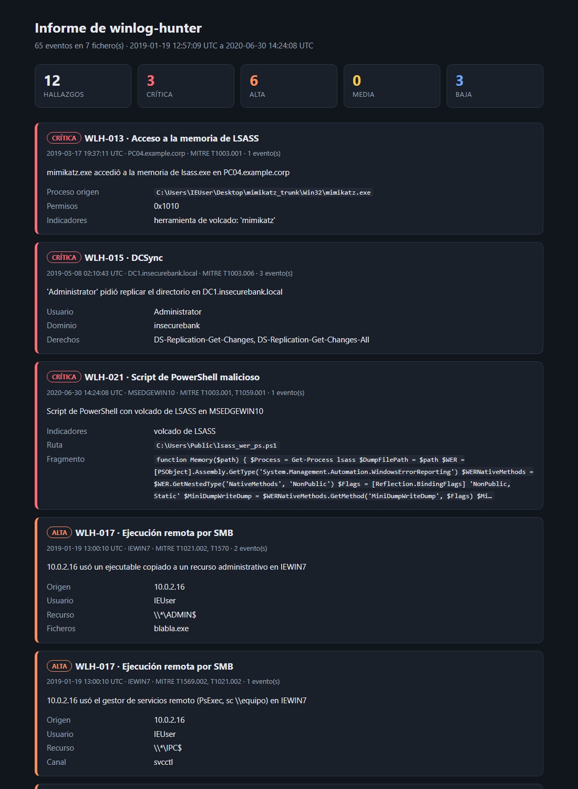

# winlog-hunter

[](https://pypi.org/project/winlog-hunter/) [](LICENSE) [](https://github.com/BV-cs0/winlog-hunter/actions/workflows/tests.yml)

Analizador de logs de Windows para blue team. Lee eventos de **Security**, **System**, **Sysmon** y **PowerShell**, detecta actividad sospechosa con 21 reglas y genera un informe con cada hallazgo mapeado a **MITRE ATT&CK**. Las reglas también están en formato **Sigma** para usarlas en cualquier SIEM.



## Instalación

Necesitas Python 3.9 o superior.

```bash
python -m pip install winlog-hunter
```

Para actualizar a la última versión: `python -m pip install --upgrade winlog-hunter`.

## Uso

**1. Abre PowerShell como administrador** (sin administrador funciona, pero se omite el log Security).

**2. Analiza tu equipo:**

```powershell
winlog-hunter equipo
```

Exporta los logs de las últimas 24 horas, los analiza y abre el informe en el navegador. Se guarda en `Documentos\winlog-hunter` con la fecha en el nombre.

> Para analizar más tiempo: `winlog-hunter equipo --horas 72`. Todas las opciones: `winlog-hunter equipo --help`.

## Detecciones

| ID | Detección | Eventos | MITRE ATT&CK |
|---|---|---|---|
| WLH-001 | Fuerza bruta (muchos fallos, misma cuenta y origen) | 4625 | T1110.001 |
| WLH-002 | Password spraying (un origen, muchas cuentas) | 4625 | T1110.003 |
| WLH-003 | Inicio de sesión correcto justo después de una fuerza bruta | 4625 → 4624 | T1110, T1078 |
| WLH-004 | Movimiento lateral (misma cuenta en varios equipos) | 4624 tipo 3/10 | T1021 |
| WLH-005 | Registro de eventos borrado | 1102, 104 | T1685.005 |
| WLH-006 | Servicio nuevo; alta si es PsExec o ejecuta algo sospechoso | 7045 | T1543.003, T1569.002 |
| WLH-007 | Tarea programada; alta si lanza PowerShell, scripts o rutas raras | 4698 | T1053.005 |
| WLH-008 | Cuenta de usuario creada | 4720 | T1136 |
| WLH-009 | Alta en grupo privilegiado (por SID, vale en cualquier idioma) | 4728, 4732, 4756 | T1098 |
| WLH-010 | PowerShell sospechoso; decodifica `-EncodedCommand` | Sysmon 1, 4688 | T1059.001 |
| WLH-011 | LOLBins: certutil, mshta, rundll32, regsvr32, bitsadmin, wmic | Sysmon 1, 4688 | T1218, T1105, T1197, T1047 |
| WLH-012 | Office (Word, Excel, Outlook...) lanzando una shell | Sysmon 1, 4688 | T1566.001, T1204.002 |
| WLH-013 | Acceso a la memoria de LSASS (Mimikatz, procdump...) | Sysmon 10 | T1003.001 |
| WLH-014 | Comandos de volcado: comsvcs MiniDump, ntdsutil, reg save SAM | Sysmon 1, 4688 | T1003.001-.003 |
| WLH-015 | DCSync: replicación de AD pedida por un usuario | 4662 | T1003.006 |
| WLH-016 | Kerberoasting: tickets de servicio RC4 | 4769 | T1558.003 |
| WLH-017 | Ejecución remota por SMB: PsExec, svcctl, atsvc, copia a ADMIN$ | 5145 | T1021.002, T1569.002 |
| WLH-018 | Shell lanzada por WMI o WinRM (wmiexec, Invoke-Command) | Sysmon 1, 4688 | T1047, T1021.006 |
| WLH-019 | Persistencia en el registro: Run, Winlogon, IFEO, COM, LSA, SAM | Sysmon 13 | T1547, T1546 |
| WLH-020 | Persistencia con suscripciones WMI | Sysmon 19-21 | T1546.003 |
| WLH-021 | Script de PowerShell malicioso: volcado de LSASS, AMSI, inyección | 4104 | T1059.001, T1003.001 |

Para reducir falsos positivos, la severidad depende del contexto: un servicio o una tarea normales salen como *baja*, y uno que ejecuta `powershell -enc` sale como *alta*. Los ataques en ráfaga (500 intentos de contraseña) se agrupan en un único hallazgo.

## Resultados con ataques reales

winlog-hunter se ha probado con [EVTX-ATTACK-SAMPLES](https://github.com/sbousseaden/EVTX-ATTACK-SAMPLES): 278 ficheros `.evtx` grabados en laboratorio mientras se ejecutaban ataques reales, organizados por táctica.

| Táctica | Ficheros | Detectados |
|---|---|---|
| Credential Access | 39 | 14 |
| Lateral Movement | 47 | 13 |
| Persistence | 22 | 12 |
| Execution | 34 | 7 |
| Herramientas de pruebas automatizadas | 8 | 5 |
| Privilege Escalation | 66 | 3 |
| Defense Evasion | 36 | 2 |
| Discovery | 11 | 1 |
| Command and Control | 6 | 0 |
| Otros | 9 | 1 |
| **Total** | **278** | **58** |

No se cuentan los ficheros en los que solo salta *registro borrado*, porque el autor vació los logs antes de grabar cada ataque.

Los puntos débiles son claros: la **escalada de privilegios** (bypass de UAC, tokens, servicios vulnerables) y la **evasión de defensas**. Casi todos esos ataques necesitan reglas de Sysmon 7 (carga de DLL), 8 (hilos remotos) y 11 (ficheros creados), que aún no están implementadas.

## Activar Sysmon (recomendado)

Sin Sysmon, Windows no registra los procesos que se ejecutan, los accesos a LSASS ni los cambios en el registro, así que 9 de las 21 reglas no tienen datos. Sysmon es gratuito y de Microsoft. En PowerShell como administrador:

```powershell
# 1. Descargar Sysmon y una configuración probada (la de SwiftOnSecurity)
Invoke-WebRequest https://download.sysinternals.com/files/Sysmon.zip -OutFile $env:TEMP\Sysmon.zip
Expand-Archive $env:TEMP\Sysmon.zip $env:TEMP\Sysmon -Force
Invoke-WebRequest https://raw.githubusercontent.com/SwiftOnSecurity/sysmon-config/master/sysmonconfig-export.xml -OutFile $env:TEMP\sysmon.xml

# 2. Instalarlo
& $env:TEMP\Sysmon\Sysmon64.exe -accepteula -i $env:TEMP\sysmon.xml
```

Para la regla WLH-021, activa también el registro de bloques de script de PowerShell:

```powershell
New-Item -Path HKLM:\SOFTWARE\Policies\Microsoft\Windows\PowerShell\ScriptBlockLogging -Force |
    New-ItemProperty -Name EnableScriptBlockLogging -Value 1 -PropertyType DWord -Force
```

`winlog-hunter equipo` incluye Sysmon y PowerShell en cuanto existen.

## Cómo sacar los logs de un equipo Windows manualmente

Para analizar otro equipo, o un log concreto, expórtalo y pásaselo a winlog-hunter:

```powershell
# 1. Exportar los logs (Security requiere administrador)
wevtutil epl Security C:\temp\Security.evtx
wevtutil epl System C:\temp\System.evtx

# 2. Analizarlos y guardar el informe
winlog-hunter analyze C:\temp\Security.evtx C:\temp\System.evtx -o informe.html
```

El formato del informe se elige por la extensión: `.html`, `.md` o `.json`. También acepta `.xml` de `wevtutil qe` y JSON de Winlogbeat o de un SIEM. En Linux/macOS, para leer `.evtx` instala antes `python3 -m pip install "winlog-hunter[evtx]"`.

## Análisis automático diario del propio equipo (Windows)

Para que el informe se genere solo cada día, en PowerShell **como administrador**:

```powershell
winlog-hunter programar                 # cada día a las 09:00
winlog-hunter programar --hora 21:30    # a otra hora
winlog-hunter programar --ahora         # lanzarlo ya, sin esperar
winlog-hunter programar --estado        # comprobar que existe
winlog-hunter programar --quitar        # eliminarlo
```

- Si hay algún hallazgo **crítico**, aparece un aviso en pantalla con el resumen y la ruta del informe. Con `--avisar-desde high` también avisa de los de severidad alta.
- Los informes se guardan en `Documentos\winlog-hunter` y los de más de 30 días se borran solos.
- `ejecuciones.log`, en la misma carpeta, guarda un resumen de cada ejecución.
- Si el equipo está apagado a la hora programada, se ejecuta al encenderlo.
- Al actualizar winlog-hunter con pip, la tarea usa la versión nueva sin volver a programarla.

## Reglas Sigma

La carpeta [`sigma/`](sigma/) del repositorio tiene las 21 detecciones en formato Sigma, validadas con `sigma check`. Se convierten a la consulta de tu SIEM (Splunk, Elastic, Microsoft Sentinel, QRadar...):

```bash
git clone https://github.com/BV-cs0/winlog-hunter.git
python -m pip install sigma-cli
sigma plugin install splunk
sigma convert -t splunk -p windows-audit -p splunk_windows winlog-hunter/sigma/
```

## Seguridad del propio analizador

Los logs pueden contener datos controlados por un atacante (nombres de usuario, líneas de comandos, nombres de tareas), así que la herramienta los trata como entrada hostil:

- **HTML.** Todo el contenido se escapa y el informe lleva una **Content-Security-Policy** que bloquea cualquier script.
- **Consola.** Se eliminan los caracteres de control, para que una secuencia ANSI dentro de un log no pueda manipular la terminal.
- **XML.** Se rechazan los documentos con `DOCTYPE` (protección frente a XXE y billion laughs).
- **Markdown.** Se escapan los caracteres especiales.

## Estructura

```text
src/winlog_hunter/
  parsers.py   lectura de EVTX / XML / JSON y normalización de eventos
  rules.py     las 21 reglas de detección mapeadas a MITRE ATT&CK
  report.py    informe en consola, HTML, Markdown y JSON
  local.py     análisis del propio equipo, aviso en pantalla y tarea programada
  cli.py       comando winlog-hunter (analyze, equipo, programar, rules)
sigma/         las reglas en formato Sigma
docs/          captura del informe
samples/       datos sintéticos que usan los tests
tests/         tests automáticos
```

Úsalo solo con logs de equipos que tengas autorización para analizar. Licencia MIT.
